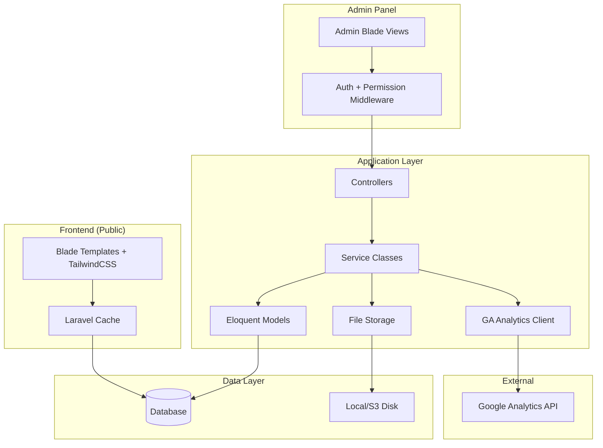
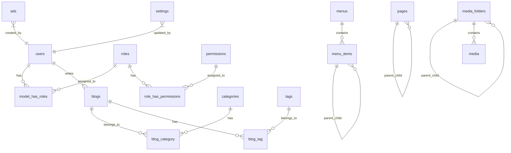
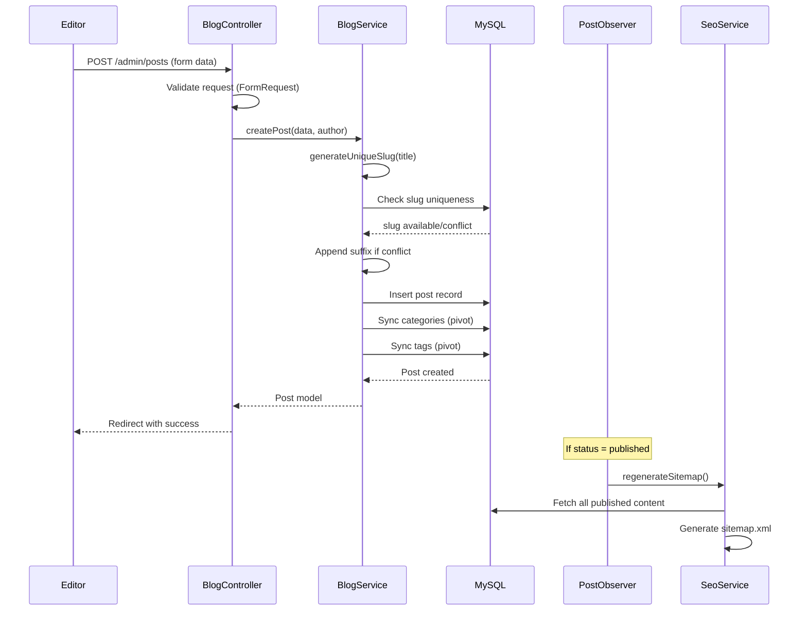
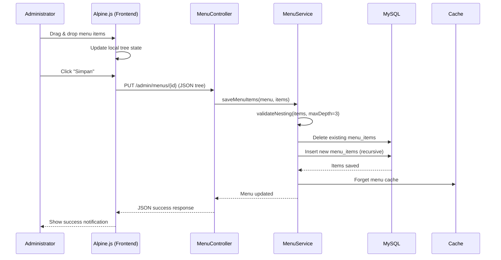
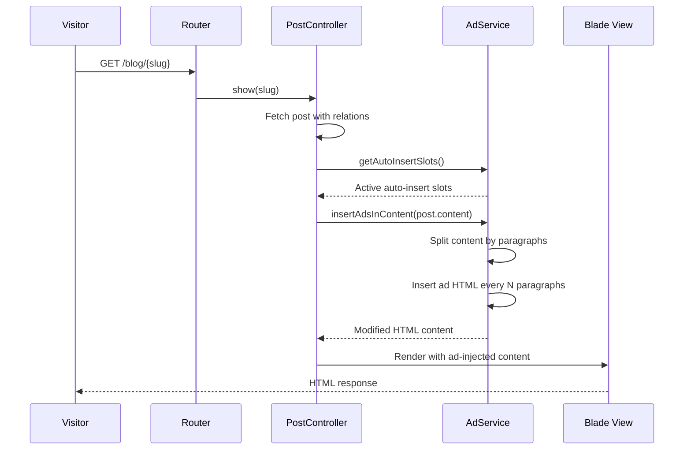

# Design Document: MonetraPay CMS

## Overview

MonetraPay CMS adalah sistem manajemen konten berbasis Laravel 12 untuk website company profile yang mempromosikan aplikasi MonetraPay (pulsa, PPOB, top-up game, e-money). Sistem ini menggunakan arsitektur monolitik Laravel dengan Blade templating, TailwindCSS v4 untuk styling, dan Vite sebagai build tool.

### Technology Stack

| Layer | Technology | Rationale |
|-------|-----------|-----------|
| Backend Framework | Laravel 12 | Already in project, mature CMS ecosystem |
| PHP Version | 8.2+ | Required by Laravel 12 |
| Frontend Styling | TailwindCSS 4 | Already configured with Vite plugin |
| Build Tool | Vite 7 | Already configured |
| Database | MySQL | Consistent database for both development and production environments |
| Testing | Pest 3 | Already configured in project |
| Auth | Laravel built-in + Spatie Permission | Industry standard for role/permission |
| Rich Text Editor | TinyMCE 6 | Feature-rich, free tier sufficient, good Laravel integration |
| File Storage | Laravel Filesystem (local/S3) | Built-in abstraction |
| Analytics | Google Analytics Data API v1 | Official GA4 reporting API |
| Drag & Drop | SortableJS | Lightweight, no jQuery dependency |

### Key Technical Decisions

1. **Spatie Laravel-Permission** for role/permission system — battle-tested package with granular permission support, middleware, and Blade directives
2. **TinyMCE** for rich text editor — provides WYSIWYG with image insertion, video embed, and clean HTML output
3. **SortableJS** for menu builder drag-and-drop — lightweight vanilla JS library
4. **Laravel Blade** (not Livewire/Inertia) — simpler architecture for a content-focused CMS, better SEO for frontend
5. **Cache-based analytics** — Google Analytics data cached for 60 minutes to reduce API calls
6. **Soft deletes with scheduled cleanup** — 30-day trash retention using Laravel's `SoftDeletes` trait and scheduled command

## Architecture



### Directory Structure

```
app/
├── Http/
│   ├── Controllers/
│   │   ├── Admin/
│   │   │   ├── DashboardController.php
│   │   │   ├── BlogController.php
│   │   │   ├── CategoryController.php
│   │   │   ├── PageController.php
│   │   │   ├── MenuController.php
│   │   │   ├── FileManagerController.php
│   │   │   ├── AdController.php
│   │   │   ├── SettingController.php
│   │   │   ├── UserController.php
│   │   │   └── RoleController.php
│   │   └── Frontend/
│   │       ├── HomeController.php
│   │       ├── BlogController.php
│   │       ├── PageController.php
│   │       ├── CategoryController.php
│   │       └── SearchController.php
│   ├── Middleware/
│   │   └── CheckMaintenanceMode.php
│   └── Requests/
│       ├── Admin/
│       │   ├── BlogRequest.php
│       │   ├── PageRequest.php
│       │   ├── MenuRequest.php
│       │   ├── AdRequest.php
│       │   ├── SettingRequest.php
│       │   └── RoleRequest.php
│       └── ...
├── Models/
│   ├── User.php
│   ├── Blog.php
│   ├── Category.php
│   ├── Tag.php
│   ├── Page.php
│   ├── Menu.php
│   ├── MenuItem.php
│   ├── Media.php
│   ├── MediaFolder.php
│   ├── Ad.php
│   └── Setting.php
├── Services/
│   ├── SlugService.php
│   ├── SeoService.php
│   ├── AdInsertionService.php
│   ├── AnalyticsService.php
│   ├── MenuService.php
│   ├── FileManagerService.php
│   └── SitemapService.php
├── Console/
│   └── Commands/
│       ├── CleanTrash.php
│       └── DeactivateExpiredAds.php
└── Observers/
    ├── BlogObserver.php
    └── PageObserver.php

resources/views/
├── admin/
│   ├── layouts/
│   │   └── app.blade.php
│   ├── dashboard/
│   ├── blogs/
│   ├── categories/
│   ├── pages/
│   ├── menus/
│   ├── files/
│   ├── ads/
│   ├── settings/
│   ├── users/
│   └── roles/
├── frontend/
│   ├── layouts/
│   │   └── app.blade.php
│   ├── home.blade.php
│   ├── blog/
│   ├── page/
│   ├── category/
│   ├── search.blade.php
│   ├── maintenance.blade.php
│   └── errors/
│       ├── 403.blade.php
│       └── 404.blade.php
└── components/
    ├── navbar.blade.php
    ├── footer.blade.php
    ├── breadcrumb.blade.php
    ├── ad-slot.blade.php
    └── seo-meta.blade.php
```

## Components and Interfaces

### Service Layer

#### SlugService

```php
class SlugService
{
    /**
     * Generate a URL-friendly slug from a title.
     * Converts to lowercase, replaces spaces/special chars with hyphens,
     * removes non-alphanumeric chars except hyphens.
     */
    public function generate(string $title): string;

    /**
     * Ensure slug uniqueness within a model's table.
     * Appends numeric suffix (-2, -3, etc.) if slug exists.
     */
    public function makeUnique(string $slug, string $modelClass, ?int $excludeId = null): string;
}
```

#### AdInsertionService

```php
class AdInsertionService
{
    /**
     * Insert ads into blog content at every Nth paragraph.
     * Does NOT modify stored content — only transforms for rendering.
     *
     * @param string $htmlContent The blog post HTML content
     * @param Collection $activeAds Active auto-insert ad slots
     * @return string HTML content with ads inserted
     */
    public function insertAdsInContent(string $htmlContent, Collection $activeAds): string;

    /**
     * Get the positions where ads should be inserted.
     * For interval N, positions are: N, 2N, 3N, ... up to paragraph count.
     * If paragraph count < N, no ads are inserted.
     */
    public function calculateInsertPositions(int $paragraphCount, int $interval): array;
}
```

#### SeoService

```php
class SeoService
{
    /**
     * Generate meta tags array for a given page/post.
     * Falls back to global defaults if page-specific values are empty.
     */
    public function getMetaTags(Model $content): array;

    /**
     * Generate Open Graph tags for a page/post.
     */
    public function getOpenGraphTags(Model $content, string $url): array;

    /**
     * Generate Twitter Card tags for a page/post.
     */
    public function getTwitterCardTags(Model $content): array;

    /**
     * Generate canonical URL for a page.
     */
    public function getCanonicalUrl(Model $content): string;

    /**
     * Generate JSON-LD structured data.
     */
    public function getStructuredData(Model $content): array;
}
```

#### SitemapService

```php
class SitemapService
{
    /**
     * Regenerate sitemap.xml with all published content.
     * Includes: homepage, published blog posts, published pages, categories.
     */
    public function regenerate(): void;
}
```

#### AnalyticsService

```php
class AnalyticsService
{
    /**
     * Get summary metrics (users, pageviews, bounce rate, avg session duration)
     * for the last 7 days. Cached for 60 minutes.
     */
    public function getSummary(): array;

    /**
     * Get daily visitor trend for the last 30 days.
     * Cached for 60 minutes.
     */
    public function getDailyTrend(): array;

    /**
     * Get top 10 pages by pageviews for the last 30 days.
     * Cached for 60 minutes.
     */
    public function getTopPages(): array;
}
```

#### MenuService

```php
class MenuService
{
    /**
     * Build nested menu tree from flat menu items.
     * Validates max depth of 3 levels.
     */
    public function buildTree(int $menuId): array;

    /**
     * Save menu item order from drag-and-drop data.
     */
    public function saveOrder(int $menuId, array $items): void;

    /**
     * Validate menu structure constraints (max 3 levels, max 50 items).
     */
    public function validateStructure(array $items): bool;
}
```

### Middleware

#### CheckMaintenanceMode

```php
class CheckMaintenanceMode
{
    /**
     * If maintenance mode is active, show "Coming Soon" page
     * to unauthenticated visitors. Authenticated admins bypass.
     */
    public function handle(Request $request, Closure $next): Response;
}
```

### Form Requests (Validation)

Key validation rules encapsulated in Form Request classes:

- **BlogRequest**: title (max:200), slug (max:220, regex, unique), content (required, max:100000), categories (array, min:1, max:5), tags (array, max:10), featured_image (image, max:2048), meta_title (max:60), meta_description (max:160)
- **PageRequest**: title (max:200), slug (max:200, unique), parent_id (exists, max depth 3), template (in:available_templates)
- **MenuRequest**: items (array, max:50), items.*.label (max:100), items.*.url (url), depth validation (max:3)
- **AdRequest**: name (max:100), type (in:adsense,adstera,manual), code (max:5000), position, schedule dates validation
- **RoleRequest**: name (max:50, unique, regex:alphanumeric+space), permissions (array, min:1)

## Data Models

### Entity Relationship Diagram



### Database Schema

#### blogs

| Column | Type | Constraints |
|--------|------|-------------|
| id | bigint | PK, auto-increment |
| user_id | bigint | FK → users.id |
| title | varchar(200) | NOT NULL |
| slug | varchar(220) | NOT NULL, UNIQUE |
| content | longtext | NOT NULL |
| excerpt | text | NULLABLE |
| featured_image | varchar(500) | NULLABLE |
| status | enum('draft','published') | DEFAULT 'draft' |
| meta_title | varchar(60) | NULLABLE |
| meta_description | varchar(160) | NULLABLE |
| meta_keywords | varchar(500) | NULLABLE |
| published_at | timestamp | NULLABLE |
| created_at | timestamp | |
| updated_at | timestamp | |
| deleted_at | timestamp | NULLABLE (soft delete) |

#### categories

| Column | Type | Constraints |
|--------|------|-------------|
| id | bigint | PK |
| name | varchar(100) | NOT NULL |
| slug | varchar(120) | NOT NULL, UNIQUE |
| description | varchar(500) | NULLABLE |
| created_at | timestamp | |
| updated_at | timestamp | |

#### tags

| Column | Type | Constraints |
|--------|------|-------------|
| id | bigint | PK |
| name | varchar(50) | NOT NULL, UNIQUE |
| slug | varchar(60) | NOT NULL, UNIQUE |
| created_at | timestamp | |
| updated_at | timestamp | |

#### blog_category (pivot)

| Column | Type | Constraints |
|--------|------|-------------|
| blog_id | bigint | FK → blogs.id |
| category_id | bigint | FK → categories.id |

#### blog_tag (pivot)

| Column | Type | Constraints |
|--------|------|-------------|
| blog_id | bigint | FK → blogs.id |
| tag_id | bigint | FK → tags.id |

#### pages

| Column | Type | Constraints |
|--------|------|-------------|
| id | bigint | PK |
| parent_id | bigint | NULLABLE, FK → pages.id |
| title | varchar(200) | NOT NULL |
| slug | varchar(200) | NOT NULL, UNIQUE |
| content | longtext | NULLABLE |
| featured_image | varchar(500) | NULLABLE |
| template | varchar(50) | DEFAULT 'default' |
| status | enum('draft','published') | DEFAULT 'draft' |
| meta_title | varchar(60) | NULLABLE |
| meta_description | varchar(160) | NULLABLE |
| meta_keywords | varchar(500) | NULLABLE |
| order | int | DEFAULT 0 |
| created_at | timestamp | |
| updated_at | timestamp | |
| deleted_at | timestamp | NULLABLE |

#### menus

| Column | Type | Constraints |
|--------|------|-------------|
| id | bigint | PK |
| name | varchar(100) | NOT NULL |
| location | varchar(50) | NOT NULL (header/footer/sidebar) |
| is_active | boolean | DEFAULT true |
| created_at | timestamp | |
| updated_at | timestamp | |

#### menu_items

| Column | Type | Constraints |
|--------|------|-------------|
| id | bigint | PK |
| menu_id | bigint | FK → menus.id |
| parent_id | bigint | NULLABLE, FK → menu_items.id |
| type | enum('custom','page','category','external') | NOT NULL |
| label | varchar(100) | NOT NULL |
| url | varchar(500) | NULLABLE |
| target | varchar(20) | DEFAULT '_self' |
| page_id | bigint | NULLABLE, FK → pages.id |
| category_id | bigint | NULLABLE, FK → categories.id |
| order | int | DEFAULT 0 |
| created_at | timestamp | |
| updated_at | timestamp | |

#### media

| Column | Type | Constraints |
|--------|------|-------------|
| id | bigint | PK |
| folder_id | bigint | NULLABLE, FK → media_folders.id |
| user_id | bigint | FK → users.id |
| filename | varchar(255) | NOT NULL |
| original_name | varchar(255) | NOT NULL |
| mime_type | varchar(100) | NOT NULL |
| size | bigint | NOT NULL (bytes) |
| path | varchar(500) | NOT NULL |
| thumbnail_path | varchar(500) | NULLABLE |
| created_at | timestamp | |
| updated_at | timestamp | |

#### media_folders

| Column | Type | Constraints |
|--------|------|-------------|
| id | bigint | PK |
| parent_id | bigint | NULLABLE, FK → media_folders.id |
| name | varchar(100) | NOT NULL |
| created_at | timestamp | |
| updated_at | timestamp | |

#### ads

| Column | Type | Constraints |
|--------|------|-------------|
| id | bigint | PK |
| user_id | bigint | FK → users.id |
| name | varchar(100) | NOT NULL |
| type | enum('adsense','adstera','manual') | NOT NULL |
| code | text | NULLABLE (max 5000 chars) |
| image | varchar(500) | NULLABLE |
| position | enum('header','sidebar','in_content','auto_insert','footer') | NOT NULL |
| paragraph_number | int | NULLABLE (for in_content: 1-20) |
| interval | int | NULLABLE (for auto_insert: 2-10) |
| is_active | boolean | DEFAULT false |
| start_date | date | NULLABLE |
| end_date | date | NULLABLE |
| created_at | timestamp | |
| updated_at | timestamp | |

#### settings

| Column | Type | Constraints |
|--------|------|-------------|
| id | bigint | PK |
| key | varchar(100) | NOT NULL, UNIQUE |
| value | text | NULLABLE |
| group | varchar(50) | NOT NULL (general/social/seo/footer) |
| created_at | timestamp | |
| updated_at | timestamp | |

## Correctness Properties

*A property is a characteristic or behavior that should hold true across all valid executions of a system — essentially, a formal statement about what the system should do. Properties serve as the bridge between human-readable specifications and machine-verifiable correctness guarantees.*

### Property 1: Slug generation produces valid format

*For any* non-empty string title, the generated slug SHALL contain only lowercase letters, digits, and hyphens, SHALL NOT start or end with a hyphen, and SHALL NOT contain consecutive hyphens.

**Validates: Requirements 2.2, 3.2**

### Property 2: Slug uniqueness resolution

*For any* slug that already exists in the database, the `makeUnique` function SHALL return a slug with a numeric suffix that does not exist in the database, and the returned slug SHALL still be a valid slug format.

**Validates: Requirements 2.3, 3.3**

### Property 3: Permission-based route access control

*For any* user with a given set of permissions and any protected admin route, the authorization middleware SHALL return 403 if and only if the user lacks the required permission for that route's module and operation.

**Validates: Requirements 1.4, 1.6, 1.7**

### Property 4: Menu structure depth validation

*For any* menu configuration, the `validateStructure` function SHALL return true if and only if the maximum nesting depth is at most 3 levels and the total item count is at most 50.

**Validates: Requirements 4.3, 4.4**

### Property 5: File upload validation

*For any* uploaded file, the validation SHALL accept the file if and only if its MIME type is in the allowed list (jpg, png, gif, webp, svg, pdf, doc, docx) AND its size is at most 10MB.

**Validates: Requirements 5.2, 5.3**

### Property 6: Auto-insert ad placement

*For any* HTML content with P paragraphs and an interval N (2-10), the `insertAdsInContent` function SHALL insert ads after paragraphs at positions N, 2N, 3N, ... up to P. If P < N, no ads SHALL be inserted. The original paragraph content and order SHALL remain unchanged.

**Validates: Requirements 9.11, 9.12, 11.6**

### Property 7: Text editor HTML output semantic validity

*For any* content produced by the Text_Editor, the output HTML SHALL contain only semantic tags (p, h1-h6, ul, ol, li, blockquote, pre, code, a, img, strong, em, u), SHALL NOT contain inline style attributes, and SHALL NOT contain empty tags (tags with no text content or child elements).

**Validates: Requirements 6.6**

### Property 8: Video embed URL transformation

*For any* valid YouTube URL (youtube.com/watch?v=ID or youtu.be/ID) or Vimeo URL (vimeo.com/ID), the embed transformation SHALL produce a valid iframe src URL in the correct embed format (youtube.com/embed/ID or player.vimeo.com/video/ID).

**Validates: Requirements 6.4, 6.5**

### Property 9: Sitemap contains exactly published content

*For any* set of blog posts, pages, and categories in the database, the generated sitemap.xml SHALL contain URLs for all items with status "published" and SHALL NOT contain URLs for items with status "draft" or soft-deleted items.

**Validates: Requirements 7.2**

### Property 10: SEO meta tag completeness

*For any* published page or blog post, the rendered HTML head SHALL contain valid Open Graph tags (og:title, og:description, og:image, og:url, og:type) and Twitter Card tags (twitter:card, twitter:title, twitter:description, twitter:image), with values derived from the content's meta fields or global defaults.

**Validates: Requirements 7.5, 7.6**

### Property 11: Blog filter correctness

*For any* combination of filter criteria (status, category, date range), the Blog_Manager query SHALL return exactly the blog posts that match ALL specified criteria, and no posts that fail any criterion.

**Validates: Requirements 2.7**

### Property 12: Ad schedule auto-deactivation

*For any* ad slot with an end_date in the past, the scheduled deactivation command SHALL set is_active to false. Ad slots without end_date or with future end_date SHALL remain unchanged.

**Validates: Requirements 9.6**

## Error Handling

### Strategy

| Error Type | Handling Approach |
|-----------|-------------------|
| Validation errors | Form Request classes return 422 with field-specific messages |
| Authorization errors | Middleware returns 403 Forbidden page |
| Not found | Model binding returns 404 page |
| File upload errors | Catch exceptions, return user-friendly error messages |
| GA API failures | Catch exception, show error message, serve cached data |
| Database errors | Transaction rollback, log error, show generic error |
| Maintenance mode | Custom middleware shows Coming Soon page |

### Error Response Patterns

**Admin Panel**: Flash messages with Bootstrap-style alerts (success/error/warning)
**Frontend**: Custom error pages (404, 403, 500) with navigation back to homepage
**API/AJAX**: JSON responses with error codes and messages

### Logging

- All errors logged via Laravel's logging system
- Critical errors (database, file system) trigger immediate notification
- GA API failures logged with context for debugging

## Testing Strategy

### Testing Framework

- **Pest 3** (already configured) for all tests
- **Property-based testing**: Use `pestphp/pest` with custom data providers generating 100+ random inputs per property
- **Feature tests**: HTTP tests for controller actions and middleware
- **Unit tests**: Service class logic, model methods

### Test Organization

```
tests/
├── Unit/
│   ├── Services/
│   │   ├── SlugServiceTest.php
│   │   ├── AdInsertionServiceTest.php
│   │   ├── SeoServiceTest.php
│   │   ├── MenuServiceTest.php
│   │   └── SitemapServiceTest.php
│   └── Models/
│       ├── BlogTest.php
│       └── PageTest.php
├── Feature/
│   ├── Admin/
│   │   ├── BlogControllerTest.php
│   │   ├── PageControllerTest.php
│   │   ├── MenuControllerTest.php
│   │   ├── AdControllerTest.php
│   │   ├── SettingControllerTest.php
│   │   ├── RoleControllerTest.php
│   │   └── FileManagerControllerTest.php
│   ├── Frontend/
│   │   ├── HomeTest.php
│   │   ├── BlogTest.php
│   │   ├── PageTest.php
│   │   └── SearchTest.php
│   └── Middleware/
│       ├── PermissionTest.php
│       └── MaintenanceModeTest.php
└── Property/
    ├── SlugGenerationTest.php
    ├── SlugUniquenessTest.php
    ├── PermissionAccessTest.php
    ├── MenuStructureTest.php
    ├── FileValidationTest.php
    ├── AdInsertionTest.php
    ├── HtmlOutputTest.php
    ├── VideoEmbedTest.php
    ├── SitemapTest.php
    ├── SeoMetaTest.php
    ├── BlogFilterTest.php
    └── AdScheduleTest.php
```

### Property-Based Testing Configuration

- Library: Pest with custom data providers using `Faker` for random input generation
- Minimum 100 iterations per property test
- Each test tagged with: `Feature: monetrapay-cms, Property {N}: {title}`
- Properties test pure service logic with mocked dependencies where needed

### Test Coverage Goals

- Unit tests: All service methods, model accessors/mutators
- Feature tests: All admin CRUD operations, frontend page rendering
- Property tests: All 12 correctness properties
- Integration tests: GA API integration (mocked), file upload flow


### Model: Media (File Manager)

```php
// Table: media
interface MediaSchema {
    id: bigint (PK)
    name: string(255)
    file_name: string(255)
    mime_type: string(100)
    path: string(500)
    thumbnail_path: string(500, nullable)
    size: bigint // bytes
    folder_id: bigint(nullable, FK -> media_folders.id)
    uploaded_by: bigint (FK -> users.id)
    created_at: timestamp
    updated_at: timestamp
}

// Table: media_folders
interface MediaFolderSchema {
    id: bigint (PK)
    name: string(100)
    parent_id: bigint(nullable, FK -> media_folders.id)
    depth: integer(default: 0) // max 5 levels
    created_at: timestamp
    updated_at: timestamp
}
```

### Model: Ad Slot

```php
// Table: ad_slots
interface AdSlotSchema {
    id: bigint (PK)
    name: string(100)
    type: enum('adsense', 'adstera', 'manual')
    code: text(5000, nullable) // script code for adsense/adstera
    image: string(255, nullable) // for manual image ads
    custom_html: text(10000, nullable) // for manual HTML ads
    position: enum('header', 'sidebar', 'in_content', 'auto_insert', 'footer')
    paragraph_number: integer(nullable) // for in_content: after paragraph N
    auto_insert_interval: integer(nullable) // for auto_insert: every N paragraphs (2-10)
    status: enum('active', 'inactive', default: 'inactive')
    start_date: date(nullable)
    end_date: date(nullable)
    order: integer(default: 0)
    created_at: timestamp
    updated_at: timestamp
}
```

### Model: Setting

```php
// Table: settings
interface SettingSchema {
    id: bigint (PK)
    group: string(50) // general, social, seo, footer, maintenance
    key: string(100)
    value: text(nullable)
    type: enum('string', 'text', 'boolean', 'file', 'json')
    created_at: timestamp
    updated_at: timestamp
}
// Unique constraint on (group, key)
```

**Validation Rules**:
- Post: title required max:200, slug unique max:220, content required, categories 1-5, tags max 10
- Category: name required max:100, slug unique max:120
- Page: title required max:200, slug unique max:200, parent depth max 3
- Menu: max 50 items, max 3 levels depth, max 10 active menus
- Media: file types (jpg,png,gif,webp,svg,pdf,doc,docx), max 10MB
- Ad Slot: max 5 active per position, interval 2-10 for auto-insert
- Settings: email format, URL format, file size limits per type


## Sequence Diagrams

### Blog Post Creation Flow



### Menu Builder Save Flow



### Ad Auto-Insert in Blog Post




## Route Design

### Admin Panel Routes (prefix: /admin, middleware: auth, check-permission)

```php
// Authentication
Route::get('/login', [AuthController::class, 'showLogin']);
Route::post('/login', [AuthController::class, 'login']);
Route::post('/logout', [AuthController::class, 'logout']);

// Dashboard
Route::get('/admin/dashboard', [DashboardController::class, 'index']);

// Blog Management
Route::resource('/admin/posts', PostController::class);
Route::post('/admin/posts/{post}/trash', [PostController::class, 'trash']);
Route::post('/admin/posts/{post}/restore', [PostController::class, 'restore']);
Route::delete('/admin/posts/{post}/force-delete', [PostController::class, 'forceDelete']);
Route::resource('/admin/categories', CategoryController::class);

// Page Management
Route::resource('/admin/pages', PageController::class);
Route::post('/admin/pages/{page}/trash', [PageController::class, 'trash']);
Route::post('/admin/pages/{page}/restore', [PageController::class, 'restore']);

// Menu Builder
Route::resource('/admin/menus', MenuController::class);
Route::put('/admin/menus/{menu}/items', [MenuController::class, 'saveItems']);

// File Manager
Route::get('/admin/files', [FileManagerController::class, 'index']);
Route::post('/admin/files/upload', [FileManagerController::class, 'upload']);
Route::delete('/admin/files/{media}', [FileManagerController::class, 'destroy']);
Route::post('/admin/files/folders', [FileManagerController::class, 'createFolder']);
Route::get('/admin/files/search', [FileManagerController::class, 'search']);

// Ad Management
Route::resource('/admin/ads', AdSlotController::class);
Route::post('/admin/ads/{ad}/toggle', [AdSlotController::class, 'toggleStatus']);

// Settings
Route::get('/admin/settings/{group}', [SettingController::class, 'edit']);
Route::put('/admin/settings/{group}', [SettingController::class, 'update']);

// Users & Roles
Route::resource('/admin/users', UserController::class);
Route::resource('/admin/roles', RoleController::class);

// Analytics
Route::get('/admin/analytics', [AnalyticsController::class, 'index']);
Route::get('/admin/analytics/data', [AnalyticsController::class, 'getData']);
```

### Frontend Routes (public)

```php
// Homepage
Route::get('/', [HomeController::class, 'index']);

// Blog
Route::get('/blog', [BlogFrontController::class, 'index']);
Route::get('/blog/{slug}', [BlogFrontController::class, 'show']);
Route::get('/category/{slug}', [BlogFrontController::class, 'category']);
Route::get('/categories', [BlogFrontController::class, 'categories']);

// Search
Route::get('/search', [SearchController::class, 'index']);

// SEO
Route::get('/sitemap.xml', [SeoController::class, 'sitemap']);
Route::get('/robots.txt', [SeoController::class, 'robots']);

// Pages (catch-all, must be last)
Route::get('/{slug}', [PageFrontController::class, 'show'])->where('slug', '.*');
```


## Key Technical Decisions

### 1. Authorization: Custom Role-Permission vs Spatie

**Decision**: Implementasi custom role-permission system tanpa package Spatie.

**Rationale**: Requirements menspesifikasikan behavior yang sangat spesifik (proteksi Super Admin, permission per module+operation, real-time update tanpa re-login). Custom implementation memberikan kontrol penuh dan menghindari overhead package yang tidak dibutuhkan. Dengan MySQL dan skala kecil, query permission per request tetap performant.

### 2. Rich Text Editor: TinyMCE

**Decision**: Menggunakan TinyMCE (self-hosted, free tier) sebagai WYSIWYG editor.

**Rationale**: TinyMCE menyediakan semua fitur yang dibutuhkan (toolbar formatting, image picker callback, video embed, fullscreen, semantic HTML output) dengan konfigurasi yang mature. Alternatif seperti CKEditor atau Quill memerlukan lebih banyak custom development untuk integrasi File Manager.

### 3. Frontend Interactivity: Alpine.js

**Decision**: Menggunakan Alpine.js untuk interaktivitas admin panel (drag-and-drop, modals, toggles, notifications).

**Rationale**: Alpine.js ringan (~15KB), terintegrasi natural dengan Blade templates, dan cukup powerful untuk kebutuhan interaktivitas CMS tanpa overhead SPA framework. Untuk drag-and-drop menu builder, menggunakan SortableJS yang kompatibel dengan Alpine.js.

### 4. Database: MySQL

**Decision**: Menggunakan MySQL untuk development dan production environment.

**Rationale**: MySQL digunakan secara konsisten di kedua environment (dev dan prod) untuk menghindari perbedaan behavior antar database engine. MySQL menyediakan fitur lengkap seperti full-text search, proper locking, dan dukungan cache driver bawaan Laravel. Konsistensi environment mengurangi risiko bug yang hanya muncul di production.

### 5. File Storage: Local Disk

**Decision**: Menggunakan local storage (storage/app/public) dengan symbolic link.

**Rationale**: Untuk single-server deployment, local storage paling sederhana dan performant. Thumbnail generation menggunakan Intervention Image. Jika perlu migrasi ke cloud storage di masa depan, Laravel Filesystem abstraction memudahkan perubahan.

### 6. Caching Strategy

**Decision**: Database cache driver untuk settings, menu, dan analytics data.

**Rationale**: MySQL mendukung cache driver bawaan Laravel (`database`), sehingga cache dapat disimpan langsung di database tanpa perlu setup tambahan seperti Redis. Alternatif file cache juga tersedia jika diperlukan. Settings dan menu di-cache karena jarang berubah. Analytics data di-cache 60 menit sesuai requirement.

### 7. Ad Insertion: Server-Side HTML Manipulation

**Decision**: Iklan auto-insert dilakukan server-side dengan parsing paragraf HTML.

**Rationale**: Server-side insertion memastikan iklan muncul di HTML response tanpa JavaScript dependency, baik untuk SEO, dan menghindari layout shift. Content asli di database tidak dimodifikasi — insertion hanya terjadi saat rendering.

### 8. SEO Sitemap: File-Based Generation

**Decision**: Sitemap.xml di-generate sebagai file statis yang di-regenerate via Observer.

**Rationale**: Regenerasi sitemap saat publish/update/delete content memastikan sitemap selalu up-to-date. File statis lebih performant daripada dynamic generation per request. Observer pattern memastikan regenerasi otomatis tanpa manual trigger.

### 9. Google Analytics: Server-Side API

**Decision**: Menggunakan Google Analytics Data API (GA4) server-side dengan service account.

**Rationale**: Server-side fetching memungkinkan caching, error handling, dan presentasi data yang dikontrol. Data di-cache 60 menit untuk mengurangi API calls. Fallback ke cached data jika API gagal.

### 10. Trash System: Custom Soft Delete

**Decision**: Custom `trashed_at` column instead of Laravel SoftDeletes trait.

**Rationale**: Requirements menspesifikasikan 30-hari retention sebelum permanent delete. Custom implementation dengan scheduled command (`php artisan trash:cleanup`) memberikan kontrol penuh atas retention period dan cleanup logic. Trait SoftDeletes tidak menyediakan auto-cleanup bawaan.


## Directory Structure

```
app/
├── Console/
│   └── Commands/
│       ├── CleanupTrash.php          # Scheduled: delete 30-day old trashed items
│       └── DeactivateExpiredAds.php   # Scheduled: deactivate expired ad slots
├── Enums/
│   ├── AdPosition.php
│   ├── AdType.php
│   ├── ContentStatus.php
│   └── MenuItemType.php
├── Http/
│   ├── Controllers/
│   │   ├── Admin/
│   │   │   ├── DashboardController.php
│   │   │   ├── PostController.php
│   │   │   ├── CategoryController.php
│   │   │   ├── PageController.php
│   │   │   ├── MenuController.php
│   │   │   ├── FileManagerController.php
│   │   │   ├── AdSlotController.php
│   │   │   ├── SettingController.php
│   │   │   ├── UserController.php
│   │   │   ├── RoleController.php
│   │   │   └── AnalyticsController.php
│   │   ├── Auth/
│   │   │   └── AuthController.php
│   │   └── Frontend/
│   │       ├── HomeController.php
│   │       ├── BlogFrontController.php
│   │       ├── PageFrontController.php
│   │       ├── SearchController.php
│   │       └── SeoController.php
│   ├── Middleware/
│   │   ├── CheckPermission.php
│   │   └── MaintenanceMode.php
│   └── Requests/
│       ├── PostRequest.php
│       ├── CategoryRequest.php
│       ├── PageRequest.php
│       ├── MenuRequest.php
│       ├── AdSlotRequest.php
│       ├── SettingRequest.php
│       ├── RoleRequest.php
│       └── UserRequest.php
├── Models/
│   ├── User.php
│   ├── Role.php
│   ├── Permission.php
│   ├── Post.php
│   ├── Category.php
│   ├── Tag.php
│   ├── Page.php
│   ├── Menu.php
│   ├── MenuItem.php
│   ├── Media.php
│   ├── MediaFolder.php
│   ├── AdSlot.php
│   └── Setting.php
├── Observers/
│   ├── PostObserver.php            # Trigger sitemap regeneration
│   └── PageObserver.php            # Trigger sitemap regeneration
├── Policies/
│   ├── PostPolicy.php
│   ├── PagePolicy.php
│   ├── CategoryPolicy.php
│   ├── MenuPolicy.php
│   ├── MediaPolicy.php
│   ├── AdSlotPolicy.php
│   ├── SettingPolicy.php
│   └── UserPolicy.php
├── Providers/
│   └── AppServiceProvider.php
├── Services/
│   ├── RolePermissionService.php
│   ├── BlogService.php
│   ├── CategoryService.php
│   ├── PageService.php
│   ├── MenuService.php
│   ├── FileManagerService.php
│   ├── SeoService.php
│   ├── AnalyticsService.php
│   ├── AdService.php
│   └── SettingService.php
└── Traits/
    ├── HasSlug.php                 # Auto slug generation
    └── Trashable.php               # Custom soft delete with retention
```


```
resources/
├── css/
│   └── app.css                     # TailwindCSS imports
├── js/
│   ├── app.js                      # Alpine.js, SortableJS init
│   └── editor.js                   # TinyMCE configuration
└── views/
    ├── admin/
    │   ├── layouts/
    │   │   └── app.blade.php       # Admin layout with sidebar
    │   ├── dashboard/
    │   │   └── index.blade.php
    │   ├── posts/
    │   │   ├── index.blade.php
    │   │   ├── create.blade.php
    │   │   └── edit.blade.php
    │   ├── categories/
    │   ├── pages/
    │   ├── menus/
    │   │   └── builder.blade.php   # Drag-and-drop interface
    │   ├── files/
    │   │   ├── index.blade.php     # Grid view
    │   │   └── modal.blade.php     # File picker modal
    │   ├── ads/
    │   ├── settings/
    │   ├── users/
    │   ├── roles/
    │   └── analytics/
    │       └── index.blade.php     # Widgets + charts
    ├── frontend/
    │   ├── layouts/
    │   │   └── app.blade.php       # Public layout
    │   ├── home.blade.php
    │   ├── blog/
    │   │   ├── index.blade.php
    │   │   ├── show.blade.php
    │   │   └── category.blade.php
    │   ├── page/
    │   │   └── show.blade.php
    │   ├── search.blade.php
    │   ├── maintenance.blade.php
    │   └── errors/
    │       ├── 403.blade.php
    │       └── 404.blade.php
    └── components/
        ├── admin/
        │   ├── sidebar.blade.php
        │   ├── editor.blade.php
        │   └── file-picker.blade.php
        └── frontend/
            ├── navbar.blade.php
            ├── footer.blade.php
            ├── breadcrumb.blade.php
            ├── ad-slot.blade.php
            ├── seo-meta.blade.php
            ├── blog-card.blade.php
            └── pagination.blade.php
```

## Error Handling

### Error Scenario 1: Permission Denied

**Condition**: User mengakses route tanpa permission yang sesuai
**Response**: Middleware `CheckPermission` throw `AuthorizationException`
**Recovery**: Render halaman 403 dengan navigasi kembali ke dashboard

### Error Scenario 2: File Upload Validation Failed

**Condition**: File melebihi ukuran atau tipe tidak diizinkan
**Response**: Return validation error dengan pesan spesifik (tipe/ukuran)
**Recovery**: User dapat mencoba upload ulang dengan file yang valid

### Error Scenario 3: Google Analytics API Failure

**Condition**: API timeout, invalid credentials, atau rate limit
**Response**: Log error, return cached data jika tersedia
**Recovery**: Tampilkan pesan error di widget dengan data cache terakhir, retry pada request berikutnya

### Error Scenario 4: Slug Conflict

**Condition**: Generated slug sudah digunakan oleh record lain
**Response**: Service menambahkan suffix numerik (-2, -3, dst)
**Recovery**: Otomatis — user mendapat slug unik tanpa intervensi manual

### Error Scenario 5: Menu Save Failure

**Condition**: Database error saat menyimpan menu items
**Response**: Transaction rollback, return error response
**Recovery**: Frontend mempertahankan state terakhir, user dapat retry

### Error Scenario 6: Maintenance Mode Access

**Condition**: Visitor mengakses site saat maintenance mode aktif
**Response**: Middleware intercept, render halaman "Coming Soon"
**Recovery**: Authenticated admin tetap dapat mengakses semua halaman


## Testing Strategy

### Unit Testing Approach

Menggunakan Pest PHP (sudah terinstall) untuk unit tests. Focus areas:
- Service classes: BlogService, PageService, MenuService, AdService, SeoService
- Slug generation logic (uniqueness, sanitization)
- Permission checking logic
- Ad insertion algorithm (paragraph splitting, interval calculation)
- Setting retrieval dan caching
- Validation rules per model

### Property-Based Testing Approach

**Property Test Library**: Pest PHP with custom data providers for randomized input testing.

Key properties to test:
- Slug generation selalu menghasilkan slug unik
- Ad auto-insert tidak mengubah jumlah paragraf asli (hanya menambah)
- Menu nesting validation selalu menolak depth > 3
- Permission check konsisten setelah role update

### Integration Testing Approach

- HTTP tests untuk setiap route (admin dan frontend)
- Database tests untuk model relationships dan constraints
- File upload tests dengan fake storage
- Middleware tests untuk permission dan maintenance mode

## Performance Considerations

- **Settings Cache**: Semua settings di-cache dan di-invalidate saat update
- **Menu Cache**: Menu structure di-cache per location, invalidate saat save
- **Eager Loading**: Semua queries menggunakan eager loading untuk relationships (posts with categories, tags, author)
- **Pagination**: Blog listing menggunakan cursor/offset pagination (10 per page)
- **Image Optimization**: Thumbnail generation saat upload, lazy loading di frontend
- **Asset Bundling**: Vite untuk CSS/JS bundling dan minification
- **Query Optimization**: Index pada slug, status, trashed_at, dan foreign keys

## Security Considerations

- **Authentication**: Laravel session-based auth dengan CSRF protection
- **Authorization**: Permission check per request via middleware
- **Input Validation**: FormRequest classes untuk semua input
- **File Upload**: Whitelist tipe file, ukuran limit, nama file sanitization
- **XSS Prevention**: Blade auto-escaping, TinyMCE content sanitization
- **SQL Injection**: Eloquent ORM parameterized queries
- **Ad Code Injection**: Admin-only ad code input, rendered dalam sandbox container
- **Rate Limiting**: Laravel rate limiter pada login dan file upload routes

## Dependencies

### PHP Packages (Composer)

- `laravel/framework` ^12.0 — Core framework
- `intervention/image` ^3.0 — Image manipulation dan thumbnail generation
- `google/analytics-data` ^0.x — Google Analytics Data API client
- `spatie/laravel-sitemap` ^7.0 — Sitemap generation helper (opsional, bisa custom)

### JavaScript Packages (NPM)

- `tailwindcss` ^4.0 — Utility-first CSS framework
- `alpinejs` ^3.x — Lightweight reactivity untuk admin panel
- `sortablejs` ^1.x — Drag-and-drop untuk menu builder
- `tinymce` ^7.x — Rich text editor (self-hosted)
- `chart.js` ^4.x — Grafik analytics dashboard

### Development Tools

- `pestphp/pest` ^3.8 — Testing framework (sudah terinstall)
- `laravel/pint` ^1.24 — Code style fixer (sudah terinstall)
- `vite` ^7.0 — Asset bundling (sudah terinstall)


## Correctness Properties

*A property is a characteristic or behavior that should hold true across all valid executions of a system — essentially, a formal statement about what the system should do. Properties serve as the bridge between human-readable specifications and machine-verifiable correctness guarantees.*

### Property 1: Slug Uniqueness Guarantee

*For any* title input to the slug generator, the resulting slug SHALL be unique across all existing records in the same table, achieved by appending numeric suffixes when conflicts exist.

**Validates: Requirements 2.2, 2.3, 3.2, 3.3**

### Property 2: Permission Enforcement Consistency

*For any* user with a given role, accessing any module-operation combination not in their role's permission set SHALL result in a 403 response, regardless of the access method (UI navigation or direct URL).

**Validates: Requirements 1.4, 1.6**

### Property 3: Ad Auto-Insert Paragraph Preservation

*For any* blog post content with N paragraphs and an auto-insert interval of M, the rendered output SHALL contain exactly N original paragraphs (unmodified) plus floor(N/M) inserted ad blocks, and the original paragraph order SHALL be preserved.

**Validates: Requirements 9.11, 9.12, 11.6**

### Property 4: Menu Nesting Depth Constraint

*For any* menu configuration submitted to the Menu Builder, no menu item SHALL exist at a depth greater than 3 levels (0-indexed: 0, 1, 2), and any attempt to nest beyond this limit SHALL be rejected.

**Validates: Requirements 4.3, 4.4**

### Property 5: Trash Retention Integrity

*For any* trashed blog post or page, the record SHALL remain recoverable for exactly 30 days from the trash date, and SHALL be permanently deleted only after the 30-day retention period expires.

**Validates: Requirements 2.8, 3.8**

### Property 6: Role Permission Real-Time Update

*For any* role permission modification, all users with that role SHALL have their access updated on the next HTTP request without requiring re-authentication.

**Validates: Requirements 1.7**

### Property 7: SEO Meta Fallback

*For any* published page or blog post where meta_title or meta_description is empty, the rendered HTML head SHALL contain the global default values from Setting_Manager instead of empty meta tags.

**Validates: Requirements 7.9**

### Property 8: Maintenance Mode Access Control

*For any* request to the frontend while maintenance mode is active, unauthenticated visitors SHALL receive the maintenance page, while authenticated administrators SHALL access the normal page content.

**Validates: Requirements 10.7, 11.11**

### Property 9: Category Assignment Bounds

*For any* blog post, the number of assigned categories SHALL be between 1 and 5 inclusive, and the number of tags SHALL not exceed 10.

**Validates: Requirements 2.6, 2.1**

### Property 10: Active Ad Slot Position Limit

*For any* ad position, the number of active ad slots SHALL not exceed 5 at any given time.

**Validates: Requirements 9.3**

### Property 11: File Upload Type and Size Validation

*For any* file upload attempt, files with disallowed MIME types or sizes exceeding 10MB SHALL be rejected with an appropriate error message, and no file SHALL be stored on disk.

**Validates: Requirements 5.2, 5.3**

### Property 12: Sitemap Regeneration on Content Change

*For any* publish, update, or delete operation on a blog post, page, or category, the sitemap.xml SHALL be regenerated to reflect the current state of all published content.

**Validates: Requirements 7.2**
